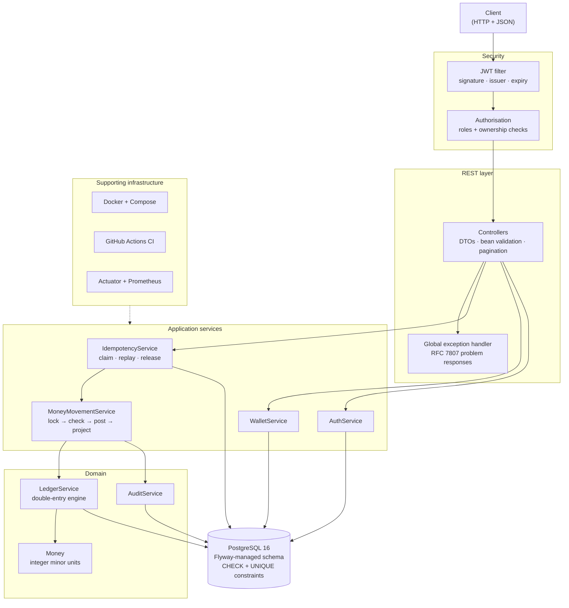
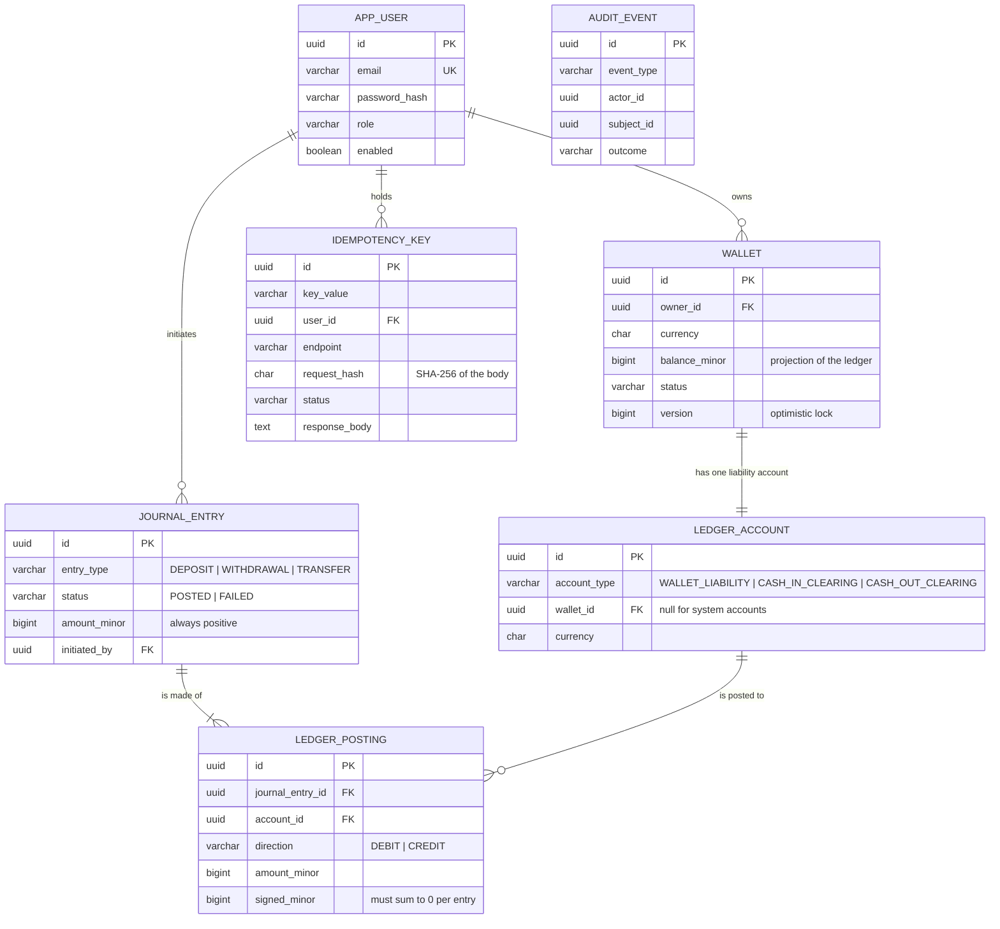

# Fintech Wallet Engine

A digital wallet backend built on a double-entry ledger, with idempotent write endpoints and concurrency-safe money movement.

**This is a personal engineering project.** It is not deployed, has no users, and processes no real money. It exists to demonstrate how I approach correctness in a domain where being approximately right is the same as being wrong.

[](https://github.com/Souhajaidi1/fintech-wallet-engine/actions/workflows/ci.yml)


---

## Why this project exists

Most wallet tutorials store a balance in a column and add to it. That works until two requests arrive at the same moment, or a client retries after a dropped connection, or someone asks where a missing 0.01 went and there is no record to consult.

This project is built around the three failures that follow from that shortcut:

| Failure | What actually happens | How it is handled here |
|---|---|---|
| Lost update | Two concurrent withdrawals both read the same balance, both pass the check, and the wallet goes negative | Row locks taken in a deterministic order, plus a database CHECK as a backstop ([ADR-004](docs/decisions/ADR-004-concurrency-strategy.md)) |
| Duplicate write | A response is lost, the client retries, and the money moves twice | Idempotency keys arbitrated by a unique constraint ([ADR-003](docs/decisions/ADR-003-idempotent-writes.md)) |
| Silent drift | Floating-point arithmetic loses fractions of a cent that nobody notices until reconciliation | Integer minor units end to end ([ADR-002](docs/decisions/ADR-002-money-representation.md)) |

## Key features

- **Double-entry ledger.** Every movement is a journal entry whose postings sum to zero. Balances are derived from the ledger, not the other way round.
- **Idempotent writes.** `POST` endpoints accept an `Idempotency-Key`. A retried request replays the original response instead of moving money again.
- **Concurrency-safe transfers.** Pessimistic row locks in a deterministic order, so concurrent transfers cannot overdraw a wallet or deadlock against each other.
- **Exact money.** Amounts are integer minor units throughout, from the HTTP boundary to the `BIGINT` column. No `float`, no `double`.
- **Reconciliation you can run.** Two SQL views recompute the invariants; an admin endpoint reports drift between a cached balance and its postings.
- **JWT security.** Stateless tokens, BCrypt at strength 12, role-based access, and ownership checks that answer 404 rather than 403 so ids cannot be enumerated.
- **Audit trail.** Append-only record of who did what, written so that a failure survives the rollback of the thing that failed.

## Architecture



Layering is conventional; the packaging is by feature. `iam`, `wallet`, `ledger`, `transaction`, `idempotency` and `audit` each own their controllers, services, entities and repositories, so a change to how transfers work touches one directory rather than four. [ADR-006](docs/decisions/ADR-006-modular-monolith.md) explains why this is a modular monolith and not microservices.

## Technology stack

| Concern | Choice |
|---|---|
| Language | Java 21 (records, pattern matching, virtual threads) |
| Framework | Spring Boot 3.3 — Web, Data JPA, Security, Validation, Actuator |
| Database | PostgreSQL 16 |
| Migrations | Flyway |
| Auth | Spring Security 6 + JJWT, BCrypt |
| API docs | springdoc-openapi (Swagger UI) |
| Testing | JUnit 5, Mockito, AssertJ, Testcontainers |
| Build & run | Maven, Docker, Docker Compose |
| CI | GitHub Actions |
| Observability | Actuator, Micrometer, Prometheus endpoint |

## Domain model



## Transaction and ledger design

A balance is not a number you edit. It is the sum of everything that happened to an account. That distinction is the whole design.

**Every movement is a balanced journal entry.** A transfer of 30.50 writes two postings: a debit of 3050 minor units against the sender's account and a credit of 3050 against the recipient's. `LedgerService.post` refuses to write an entry whose postings do not sum to zero, so "money cannot be created or destroyed" is enforced in one place rather than depended on at every call site.

**Deposits and withdrawals balance too.** They are not one-sided. A deposit credits the wallet and debits a `CASH_IN_CLEARING` system account, which represents money arriving from the outside world. In a production system that is where a card processor or bank rail would settle. Without it, a deposit would be an unbalanced entry and the books would not close.

**Balances are a maintained projection.** `wallet.balance_minor` exists so that reading a balance is one indexed row read rather than an aggregate over the whole posting history. It is updated inside the same transaction that writes the postings, so there is no window where the two disagree. Two SQL views (`unbalanced_journal_entry`, `wallet_balance_drift`) exist to prove it, and the integration tests query them directly rather than re-implementing the check in Java.

**Failures leave a trace.** A refused transfer writes a `FAILED` journal entry and an audit event in a separate transaction, because the transaction that failed is about to roll back and take any record of the failure with it.

Full reasoning in [ADR-005](docs/decisions/ADR-005-double-entry-ledger.md).

## Idempotency

The scenario this exists for is ordinary: a client posts a transfer, the server completes it, and the response is lost to a dropped connection or a mobile handover. The client cannot distinguish a lost response from a failed request, so it retries. Without a guard, the money moves twice.

```http
POST /api/v1/transfers
Authorization: Bearer <token>
Idempotency-Key: 8f14e45f-ea8f-4b7a-9c31-2d0e1f7a5b6c
Content-Type: application/json

{ "sourceWalletId": "...", "destinationWalletId": "...", "amount": "30.50" }
```

The mechanism is a unique constraint, not a lookup followed by an insert — checking whether a key exists and then inserting it is itself a race that two concurrent retries can both win. Every request instead attempts an `INSERT` on `(key_value, user_id, endpoint)` and lets PostgreSQL arbitrate. Exactly one survives, whatever the interleaving.

| Situation | Response |
|---|---|
| Key is new | `201`, operation runs, response stored |
| Key held, completed, same body | `200` with the original response and `Idempotent-Replay: true` |
| Key held, still running | `409 REQUEST_IN_FLIGHT` |
| Key held, different body | `422 IDEMPOTENCY_KEY_REUSED` |
| Key held, operation failed | Key released so a corrected retry can reuse it |

The stored request fingerprint is a SHA-256 of the body **and** the path variable. Hashing the body alone would let the same key deposit into a different wallet and be mistaken for a retry.

## Concurrency and consistency

A wallet holds 100.00. Two withdrawals of 80.00 arrive in the same millisecond.

Without a lock, both transactions read 100.00, both find 80.00 ≤ 100.00, and both write. The wallet ends at −60.00 and the platform is owed money that does not exist. This is not an exotic interleaving — it is the normal result of a user double-tapping a button, and it does not show up in testing until it happens with real money.

**The strategy is pessimistic locking.** Money movement opens with `SELECT ... FOR UPDATE` on every wallet involved, so the second transaction blocks until the first commits, then reads 20.00 and correctly refuses.

**Locks are taken in a deterministic order.** Transfers lock both wallets in a single query ordered by id. Two transfers in opposite directions between the same pair would otherwise be able to deadlock — one holding A and waiting for B while the other holds B and waits for A. Sorting the ids makes that cycle impossible.

**There are two more layers under it.** The `Wallet` entity carries a `@Version` column, so if a write path ever skips the lock the optimistic check fails loudly rather than silently. And `CHECK (balance_minor >= 0)` on the table means that even if every line of application logic were bypassed, PostgreSQL refuses to store a negative balance.

`ConcurrencyIT` fires twenty simultaneous transfers of 10.00 at a wallet holding 100.00 and asserts that exactly ten succeed. [ADR-004](docs/decisions/ADR-004-concurrency-strategy.md) explains why pessimistic locking beats optimistic retry for this workload.

## Security

- **Stateless JWT.** HS256, verified for signature, issuer and expiry on every request. No server-side session, so no CSRF surface.
- **BCrypt at strength 12.** Passwords are never logged, returned or stored in any other form.
- **Role-based access.** `USER` owns and spends; `ADMIN` reads any wallet and runs reconciliation but never moves someone else's money.
- **Ownership enforced in the service layer**, not the controller, so no endpoint can reach a wallet without passing the check.
- **404, not 403, for someone else's wallet.** A 403 would confirm the id exists and let an attacker map the id space.
- **Uniform authentication failures.** Unknown email, wrong password and disabled account return the same message, so the API cannot be used to enumerate accounts.
- **No secret has a default.** The application refuses to start without `JWT_SECRET` rather than shipping a value identical in every checkout.
- **Errors leak nothing.** Stack traces and internal messages are logged, never returned; clients get an RFC 7807 document with a stable code.

## API

All endpoints are under `/api/v1`. Interactive docs at `/swagger-ui.html` once running.

| Method | Path | Purpose |
|---|---|---|
| `POST` | `/auth/register` | Create an account |
| `POST` | `/auth/login` | Exchange credentials for a token |
| `GET` | `/auth/me` | Read your profile |
| `POST` | `/wallets` | Open a wallet |
| `GET` | `/wallets` | List your wallets |
| `GET` | `/wallets/{id}` | Read one wallet |
| `GET` | `/wallets/{id}/balance` | Read a balance |
| `POST` | `/wallets/{id}/deposit` | Credit from outside · idempotent |
| `POST` | `/wallets/{id}/withdraw` | Debit to outside · idempotent |
| `POST` | `/transfers` | Move money between wallets · idempotent |
| `GET` | `/transactions?page=&size=` | Paged history, newest first |
| `GET` | `/admin/ledger/wallets/{id}/reconciliation` | Drift check · `ADMIN` only |

Errors are RFC 7807 problem documents carrying a stable `code`:

```json
{
  "type": "https://github.com/Souhajaidi1/fintech-wallet-engine/errors",
  "title": "Unprocessable Entity",
  "status": 422,
  "detail": "The wallet does not hold enough funds.",
  "instance": "/api/v1/transfers",
  "code": "INSUFFICIENT_FUNDS",
  "timestamp": "2026-09-08T10:15:30Z"
}
```

Worked request/response examples: [docs/api-examples.md](docs/api-examples.md).

## Testing

Unit tests cover the pieces where the logic is self-contained: `Money` arithmetic and the ledger's balancing rule. Everything else runs against a real PostgreSQL through Testcontainers, because row locking, unique-constraint arbitration and CHECK constraints are behaviour of the database — an H2 test would pass while proving nothing the README claims.

| Test | What it proves |
|---|---|
| `MoneyTest` | Exact arithmetic; sub-cent precision rejected, not rounded; overflow raises |
| `LedgerBalanceTest` | An unbalanced or one-sided entry is refused before anything is written |
| `MoneyMovementIT` | Transfers move the exact amount; insufficient funds roll back completely |
| `IdempotencyIT` | Retries replay; key reuse with a different body is refused; failed operations free their key |
| `ConcurrencyIT` | Twenty simultaneous transfers, exactly ten succeed; opposite-direction transfers do not deadlock |
| `SecurityIT` | Anonymous 401, forged token rejected, cross-user access 404, passwords hashed, login failures indistinguishable |
| `LedgerReconciliationIT` | Every journal entry sums to zero; no cached balance drifts from its postings |

```bash
mvn test      # unit tests only
mvn verify    # everything, including Testcontainers integration tests
```

Integration tests need a working Docker daemon.

## Running locally

**With Docker (recommended)**

```bash
git clone https://github.com/Souhajaidi1/fintech-wallet-engine.git
cd fintech-wallet-engine

cp .env.example .env
echo "JWT_SECRET=$(openssl rand -base64 48)" >> .env

docker compose up --build
```

The API is on `http://localhost:8080`, Swagger UI on `http://localhost:8080/swagger-ui.html`. Flyway creates the schema on first start.

**Without Docker**

Needs JDK 21 and a PostgreSQL 16 you can reach.

```bash
export DB_URL=jdbc:postgresql://localhost:5432/wallet
export DB_USER=wallet
export DB_PASSWORD=wallet
export JWT_SECRET=$(openssl rand -base64 48)

mvn spring-boot:run
```

## CI/CD

[`.github/workflows/ci.yml`](.github/workflows/ci.yml) runs on every push and pull request: compile, unit tests, Testcontainers integration tests, package, and a Docker image build with layer caching. Spotless (Palantir Java Format) is configured in the `pom.xml`; run `mvn spotless:apply` to format, and `mvn spotless:check` to verify. It is not yet wired into the build.

The image is built but not pushed. There is no registry behind this project, and a pipeline that pretends to deploy somewhere it does not is worse than no pipeline.

## Observability

Actuator exposes `health`, `info`, `metrics` and `prometheus`. Health details are restricted to `ADMIN` — a public health endpoint that names the database and its version is free reconnaissance. The compose file's healthcheck polls `/actuator/health` so `docker compose up` waits for a genuinely ready service.

## Engineering decisions

Each records the alternatives considered and what would change the decision:

- [ADR-001 — PostgreSQL as the datastore](docs/decisions/ADR-001-postgresql.md)
- [ADR-002 — Money as integer minor units](docs/decisions/ADR-002-money-representation.md)
- [ADR-003 — Idempotent write endpoints](docs/decisions/ADR-003-idempotent-writes.md)
- [ADR-004 — Pessimistic locking for money movement](docs/decisions/ADR-004-concurrency-strategy.md)
- [ADR-005 — Double-entry ledger](docs/decisions/ADR-005-double-entry-ledger.md)
- [ADR-006 — Modular monolith, not microservices](docs/decisions/ADR-006-modular-monolith.md)

## Project structure

```
src/main/java/com/souhajaidi/wallet/
├── common/          Money value object, error types, RFC 7807 handler, config
├── iam/             Users, JWT, Spring Security, registration and login
├── wallet/          Wallet aggregate, balances, deposit and withdraw endpoints
├── ledger/          Double-entry engine, accounts, journal entries, postings
├── transaction/     Transfers, history, money movement orchestration
├── idempotency/     Claim/replay/release over a unique constraint
└── audit/           Append-only record of what happened

src/main/resources/db/migration/
├── V1__identity_and_wallets.sql
├── V2__ledger.sql
└── V3__idempotency_and_audit.sql

docs/
├── architecture.md
├── api-examples.md
└── decisions/       ADR-001 … ADR-006
```

## Known limits and next steps

Stated plainly, because a portfolio project that pretends to be production-ready is less convincing than one that knows what it is missing.

- **No currency conversion.** Cross-currency transfers are refused rather than converted. Doing it properly means an FX rate source, a spread, and a decision about who absorbs rounding — a project of its own.
- **Clearing accounts settle nothing.** `CASH_IN_CLEARING` and `CASH_OUT_CLEARING` model the outside world but no payment rail sits behind them.
- **Idempotency keys are never expired.** The table grows without bound. A scheduled cleanup with a documented retention window is the obvious next step.
- **A crashed request leaves its key claimed.** Retries then get `409` until an operator intervenes. A lease with a timeout would fix this.
- **Single-instance locking assumptions.** Row locks are held by PostgreSQL, so this scales horizontally as written, but throughput on a single hot wallet is bounded by lock contention. Sharding hot accounts is the standard answer.
- **No rate limiting.** Login is unthrottled and would need it before facing the internet.

## Author

**Souha Jaidi** — Software Engineer

[GitHub](https://github.com/Souhajaidi1) · [LinkedIn](https://www.linkedin.com/in/souha-jaidi/) · [Portfolio](https://souhajaidi1.github.io)
