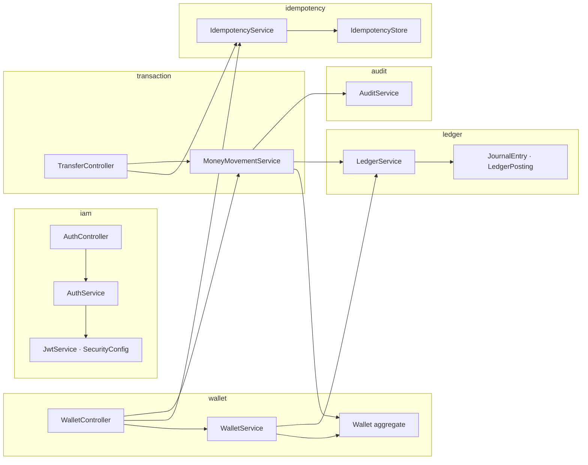
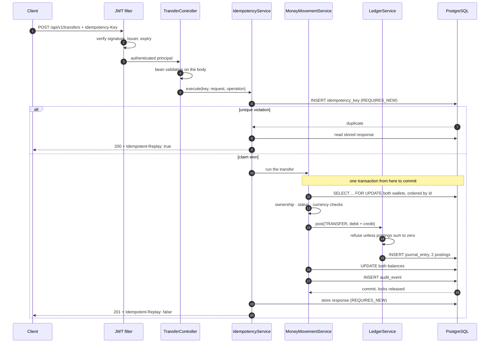

# Architecture

## Shape of the system

One Spring Boot application over one PostgreSQL database, packaged by feature. [ADR-006](decisions/ADR-006-modular-monolith.md) covers why this is not microservices.

Dependencies run one way: `transaction` depends on `ledger` and `wallet`; nothing depends on `transaction`.

## The path of a transfer

Step ordering is the design. The lock is taken **before** the balance is read, so the check is made against state nobody else can change until commit. The ledger write and the balance update share one transaction, so neither can exist without the other.

## Where each invariant is enforced

| Invariant | Enforced by | Layer |
|---|---|---|
| Amounts are exact | `Money` over `long` minor units | Domain |
| No sub-cent precision accepted | `@Digits(fraction = 2)` + `Money.ofMajor` | API + domain |
| Postings sum to zero | `LedgerService.post` | Domain |
| Balance never negative | Overdraft check under a row lock | Service |
| Balance never negative (backstop) | `CHECK (balance_minor >= 0)` | Database |
| No lost updates | `SELECT ... FOR UPDATE` | Database |
| No deadlocks | Deterministic lock ordering by id | Service |
| No duplicate writes | `UNIQUE (key_value, user_id, endpoint)` | Database |
| Only the owner spends | Ownership check in the service layer | Service |
| Cached balance matches ledger | `wallet_balance_drift` view + tests | Database |

Nothing important rests on a single layer.

## Failure handling

| Failure | Result |
|---|---|
| Insufficient funds | Whole transaction rolls back; `FAILED` entry and audit row written separately |
| Lock wait too long | Hikari 5s timeout; request fails fast rather than holding a pool connection |
| Unbalanced entry assembled | Refused before any write; logged as a server error |
| Response lost in transit | Client retries with the same key; original response replayed |
| Operation fails after claiming a key | Key released so a corrected retry can reuse it |
| Request crashes mid-flight | Key stays `IN_PROGRESS`; retries get 409. Known limit — needs a lease timeout |

## Schema

Owned by Flyway. Hibernate runs `ddl-auto: validate` and is never permitted to alter it, so an entity change that drifts from the migrations fails at startup instead of silently reshaping the database.

- `V1__identity_and_wallets.sql` — users, wallets, non-negative CHECK
- `V2__ledger.sql` — accounts, entries, postings, reconciliation views
- `V3__idempotency_and_audit.sql` — idempotency keys with the unique scope, audit events
